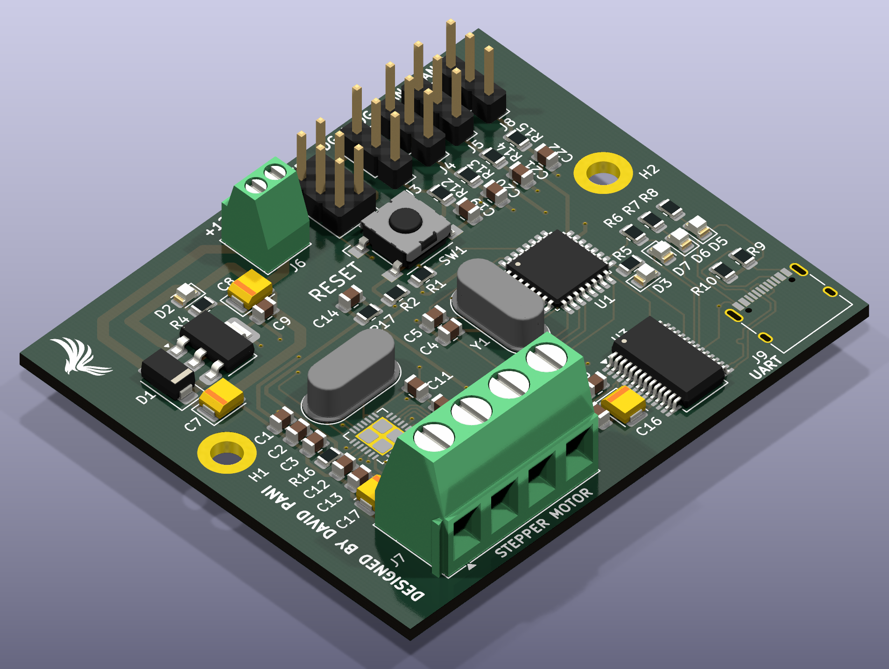
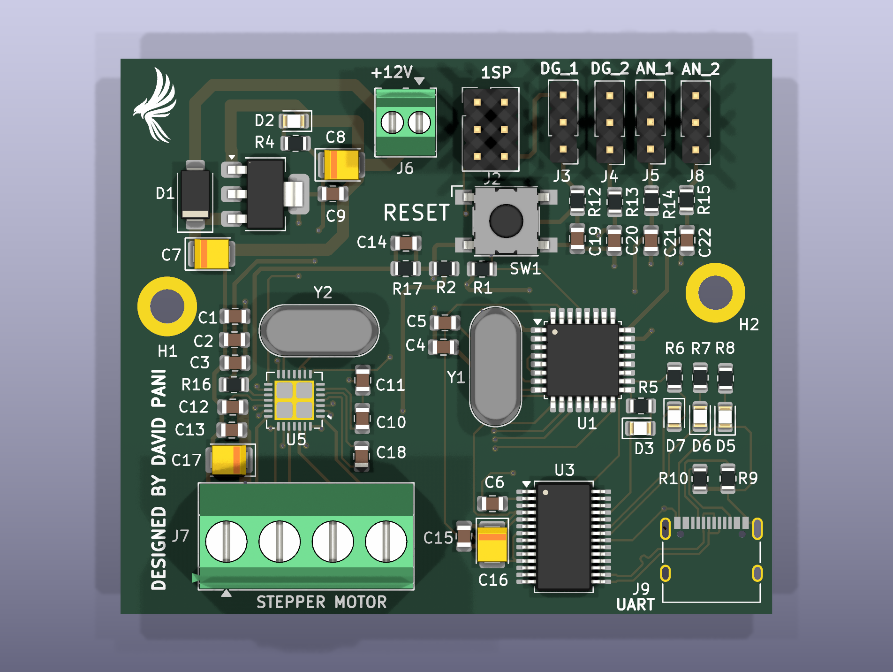
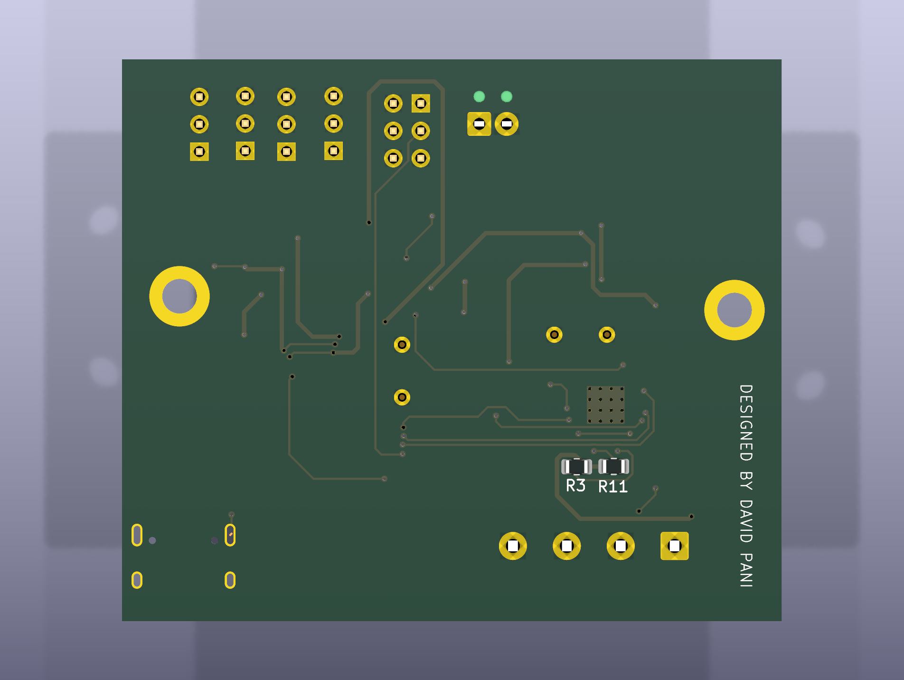

# NEMA 23 Stepper Motor Controller — Arduino-Compatible PCB

A compact, single-axis **12 V bipolar stepper motor controller** that combines an **ATmega328 microcontroller** (Arduino Uno–compatible), a **Trinamic TMC2209** silent stepper driver and an **FT232RL USB-C serial interface** on one 61 × 52 mm two-layer board.

The board is intended as a self-contained joint controller: one board drives one motor, and several boards can be networked over UART to coordinate a multi-axis machine such as a robotic arm. It was designed as the joint electronics for the [5-DOF Cycloidal Drive Robotic Arm](https://github.com/Davey09/Cycloidal-Drive-Robotic-Arm).

<p align="center">
  
</p>

| Top | Bottom |
|:---:|:---:|
|  |  |

---

## Key Features

- **Arduino-compatible MCU:** ATmega328 (TQFP-32) with a 16 MHz crystal, so it can be programmed from the Arduino IDE with standard libraries such as *AccelStepper* and *TMCStepper*
- **TMC2209 stepper driver:** up to 2 A RMS, StealthChop2 silent operation, 256-step microstep interpolation and a single-wire UART configuration interface
- **Hardware current setting:** a VREF divider (R16/R17) gives a default limit of about **1.35 A RMS** with no firmware configuration needed
- **USB-C serial bridge:** FT232RL USB-to-UART with DTR auto-reset for bootloader uploads, plus TX/RX activity LEDs
- **Robust power input:** 12 V screw terminal with a US1G series diode for **reverse-polarity protection** and an NCP1117 5 V LDO for the logic rail
- **Expansion I/O:** two filtered digital and two filtered analog 3-pin headers (signal / 5 V / GND) for limit switches, encoders or sensors
- **ICSP header** for flashing the bootloader or firmware directly
- **Manual reset button** and status LEDs
- **2 × M3 mounting holes** for installation inside a joint housing or controller chassis

## Specifications

| Parameter | Value |
|---|---|
| Supply voltage | 12 V DC (motor rail), 5 V regulated logic |
| Microcontroller | ATmega328-A, 16 MHz, 5 V |
| Motor driver | TMC2209-LA (VQFN-28, thermal-via pad) |
| Motor type | 2-phase bipolar stepper (NEMA 14 / 17 / 23) |
| Default phase current | ≈ 1.35 A RMS (hardware VREF); up to 2 A RMS via UART/VREF |
| Microstepping | 1/8 hardware default (MS1 = MS2 = GND), interpolated to 1/256 |
| Chopper mode | StealthChop2 (SPREAD = GND) |
| Current-sense resistors | 0.11 Ω |
| Host interface | USB-C (USB 2.0 full speed) through FT232RL |
| Board size | 61.2 × 52.1 mm |
| Layers | 2 (F.Cu / B.Cu), 1.6 mm FR-4 |
| Components | Mostly SMD (0805 passives), through-hole connectors |
| EDA tool | KiCad 9 |

## Circuit Description

The schematic is a hierarchical design with three sheets:

| Sheet | File | Function |
|---|---|---|
| Main | `Stepper_Controller.kicad_sch` | MCU, motor driver, USB-UART, I/O headers, LEDs |
| Power input | `Power_Supply.kicad_sch` | 12 V input, reverse-polarity protection, 5 V regulation |
| Current reference | `Current_Reference.kicad_sch` | TMC2209 VREF divider |

### Power supply
The 12 V input (J6) passes through **D1 (US1G)**, which blocks current if the supply is connected backwards. The protected 12 V rail feeds the TMC2209 motor supply (VS) directly, with 4.7 µF tantalum, 100 µF and 100 nF bulk and decoupling capacitors next to the driver. An **NCP1117-5.0 LDO (U2)** produces the 5 V `VCC` rail for the MCU, the FT232RL I/O and the expansion headers.

### Microcontroller
The **ATmega328 (U1)** runs from a 16 MHz crystal (Y1) with 22 pF load capacitors and has 100 nF decoupling on each supply pin, AVCC and AREF. RESET has a 10 kΩ pull-up, a tactile reset switch (SW1) and a 100 nF DTR-coupled capacitor, so the bootloader auto-resets the same way it does on an Arduino Uno.

### Stepper driver
The **TMC2209 (U5)** is wired for STEP/DIR control from the MCU:

| TMC2209 pin | Net | ATmega328 pin | Arduino pin |
|---|---|---|---|
| STEP | `STEP` | PD7 | D7 |
| DIR | `DIR` | PD6 | D6 |
| EN (active low) | `ENA` | PD5 | D5 |
| PDN_UART | `UART` | PD2 | D2 |

- **Motor current** is set by VREF. The divider from the driver's internal 5 V output (R16 = 10 kΩ, R17 = 6.2 kΩ, filtered by C14) gives VREF ≈ 1.91 V. With 0.11 Ω sense resistors:
  `I_RMS = (VREF / 2.5 V) × 0.325 V / (R_sense + 0.02 Ω) / √2 ≈ 1.35 A`
- **Microstepping:** MS1 and MS2 are tied low, which selects 1/8 stepping with internal interpolation to 1/256 for very smooth, quiet motion.
- **SPREAD** is tied low, so the driver runs in StealthChop2 for silent operation at low and medium speeds.
- **PDN_UART** connects to an MCU pin, so firmware can override the hardware defaults over the TMC2209 single-wire UART (run current, microstep resolution, StallGuard, CoolStep).
- The motor phases (OA1/OA2, OB1/OB2) go to a 4-way 5.08 mm screw terminal (**J7**).

### USB interface
A **USB-C receptacle (J9)** with 5.1 kΩ CC pull-downs (so the board is recognised as a sink) connects to the **FT232RL (U3)**. TXD/RXD cross over to the ATmega's hardware UART (PD0/PD1), and DTR drives the auto-reset circuit. CBUS0/CBUS1 drive the TX/RX activity LEDs.

### Expansion headers and indicators
| Header | Silkscreen | MCU signal | Notes |
|---|---|---|---|
| J3 | DG_1 | D3 (PD3, INT1 / PWM) | 1 kΩ + 160 nF RC filter |
| J4 | DG_2 | D4 (PD4) | 1 kΩ + 160 nF RC filter |
| J5 | AN_1 | A0 (PC0) | 1 kΩ + 160 nF RC filter |
| J8 | AN_2 | A1 (PC1) | 1 kΩ + 160 nF RC filter |
| J2 | ISP | — | 2 × 3 ICSP programming header |

Each 3-pin header provides **signal / 5 V / GND**, so sensors and switches plug in directly. The RC filters debounce mechanical limit switches and suppress noise coupled from the motor wiring.

LEDs show 5 V power, the D13 status signal and USB TX/RX activity.

## Repository Structure

```
├── hardware/                     KiCad 9 project (open Stepper_Controller.kicad_pro)
│   ├── Stepper_Controller.kicad_pro
│   ├── Stepper_Controller.kicad_sch
│   ├── Stepper_Controller.kicad_pcb
│   ├── Power_Supply.kicad_sch
│   └── Current_Reference.kicad_sch
├── fabrication/
│   ├── Stepper_Controller_Gerbers.zip   Gerber + Excellon drill files (ready for JLCPCB / PCBWay)
│   └── BOM.csv                          Bill of materials
├── docs/
│   └── Schematic.pdf                    Full schematic, all sheets
└── images/                              3D renders
```

## Getting Started

1. **Open the design:** install [KiCad 9](https://www.kicad.org/) and open `hardware/Stepper_Controller.kicad_pro`.
2. **Order PCBs:** upload `fabrication/Stepper_Controller_Gerbers.zip` to any PCB manufacturer (2 layers, 1.6 mm, default settings).
3. **Assemble** the board using `fabrication/BOM.csv`.
4. **Burn the bootloader** through the ICSP header using *Arduino as ISP* or a USBasp, with board type **Arduino Uno**.
5. **Upload firmware** over USB-C from the Arduino IDE. A minimal test:

```cpp
#include <AccelStepper.h>

constexpr uint8_t STEP_PIN = 7, DIR_PIN = 6, EN_PIN = 5;
AccelStepper stepper(AccelStepper::DRIVER, STEP_PIN, DIR_PIN);

void setup() {
  pinMode(EN_PIN, OUTPUT);
  digitalWrite(EN_PIN, LOW);        // enable TMC2209 (active low)
  stepper.setMaxSpeed(4000);        // microsteps/s (1/8 stepping => 1600 steps/rev)
  stepper.setAcceleration(2000);
  stepper.moveTo(1600 * 5);         // 5 motor revolutions
}

void loop() {
  if (stepper.distanceToGo() == 0) stepper.moveTo(-stepper.currentPosition());
  stepper.run();
}
```

## Revision Notes (Rev A)

These items were found in design review and are planned for Rev B:

- **ICSP header mapping:** J2 pins 1 and 4 (MISO/MOSI) are joined to each other and not connected to the MCU, and pin 3 (SCK) goes to PB4 (MISO). Route J2 to PB4/PB3/PB5 as in the standard AVR 6-pin ICSP pinout.
- **FT232RL supply:** the FT232RL VCC pin (20) and the USB-C VBUS pins are not connected. Supply VCC from VBUS or the 5 V rail and add the 3V3OUT decoupling capacitor.
- **TMC2209 clock:** Y2 is a passive crystal on the CLK pin, but the TMC2209 accepts only an external clock signal or GND (internal oscillator). Tie CLK to GND and remove Y2.
- **C13 (100 µF):** this value is not practical in an 0805 package at a 16 V+ rating. Move it to a 1210 MLCC or an electrolytic footprint.

## Roadmap

- Rev B with the fixes above
- Firmware for TMC2209 UART configuration and StallGuard sensorless homing
- Multi-board UART/RS-485 network for coordinated multi-axis motion
- Optional magnetic encoder header for closed-loop position feedback

## Related Project

This controller provides the joint electronics for the **[5-DOF Cycloidal Drive Robotic Arm](https://github.com/Davey09/Cycloidal-Drive-Robotic-Arm)**.
